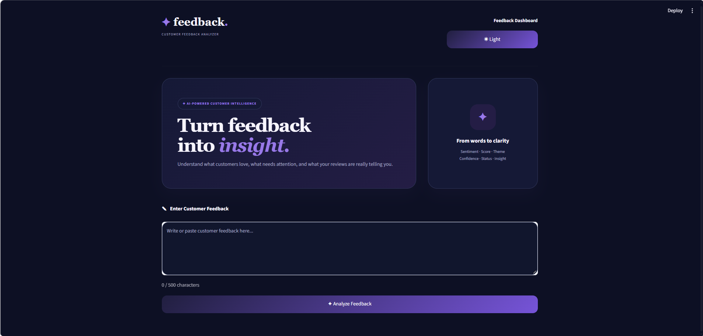
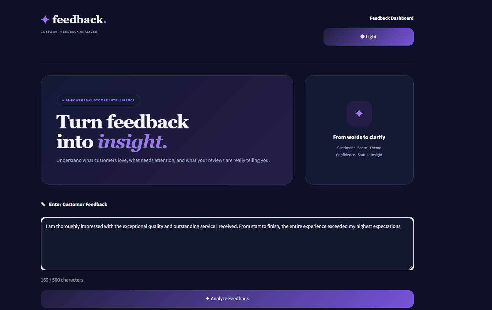
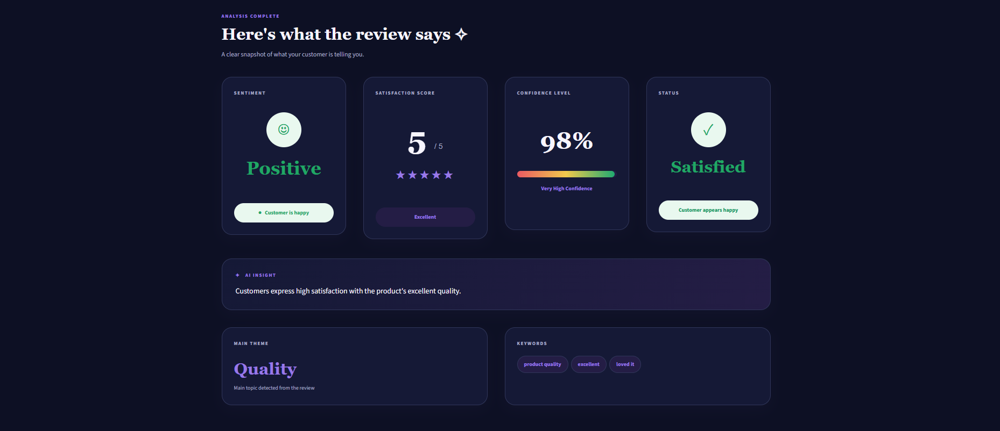
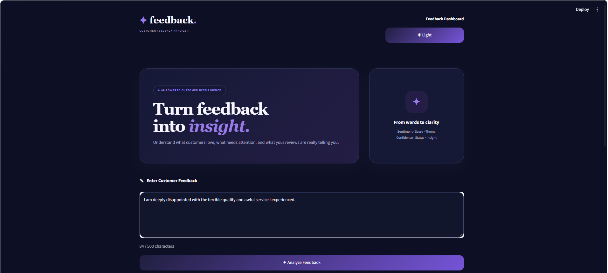
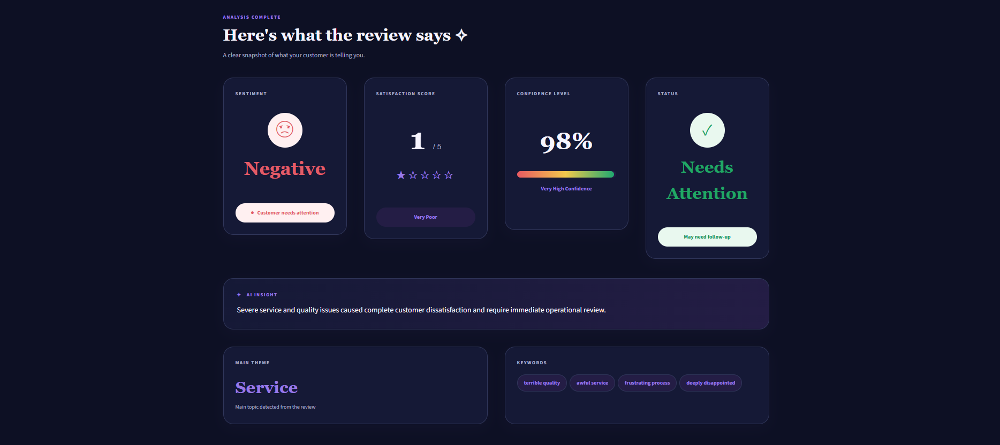

# AI Feedback Analyzer

### Turn Customer Feedback into Actionable Insights

AI Feedback Analyzer is an AI-powered customer feedback analysis application that transforms customer reviews into meaningful insights using Google's Gemini AI.

The application analyzes customer feedback, identifies customer sentiment, evaluates satisfaction levels, detects important themes, and generates actionable business insights through an interactive Streamlit dashboard.

---

## Overview

Understanding customer feedback is essential for improving products, services, and overall customer experience.

AI Feedback Analyzer simplifies this process by automatically analyzing customer reviews and converting unstructured text into structured information.

By integrating Google's Gemini AI with FastAPI and Streamlit, this application provides an easy way to understand customer opinions and identify areas that require attention.

## Application Preview

### Dashboard

The application provides a clean and interactive dashboard where users can submit customer reviews for AI-powered analysis.



### Positive Feedback Analysis

The application identifies positive customer experiences and highlights what customers appreciate about a product or service.

<p align="center">
  
  
</p>

### Negative Feedback Analysis

Negative reviews are analyzed to identify customer dissatisfaction, detect problems, and highlight areas that require improvement.

<p align="center">
  
  
</p>

---

## Features

- **Sentiment Analysis:** Classifies customer reviews into Positive, Negative, or Neutral categories.
- **Satisfaction Score:** Assigns a score between 1 and 5 based on the customer's experience.
- **Theme Detection:** Identifies the primary topic of a review, such as delivery, quality, price, or service.
- **Confidence Score:** Generates a confidence percentage representing the AI's certainty in its analysis.
- **Customer Status Classification:** Categorizes feedback into Needs Attention, Resolved, or Satisfied.
- **AI-Generated Insights:** Provides concise business insights based on the customer's feedback.
- **Keyword Extraction:** Extracts 3–5 important keywords or phrases from customer reviews.
- **Database Integration:** Stores customer reviews and their analysis results using SQLite.
- **Recent Analysis History:** Retrieves and displays the latest five analyzed reviews.
- **Interactive Dashboard:** Provides a user-friendly Streamlit interface with Light and Dark theme options.

---

## Tech Stack

| Technology | Purpose |
|---|---|
| Python | Core programming language |
| Google Gemini AI | Customer review analysis |
| FastAPI | Backend API development |
| Streamlit | Interactive frontend development |
| Pydantic | Data validation and structured responses |
| SQLite | Database management |
| Requests | HTTP communication |
| UV | Python dependency and project management |

---

## How It Works

The application follows an end-to-end review analysis workflow:

1. The user enters a customer review through the Streamlit interface.
2. The frontend sends the review to the FastAPI backend.
3. FastAPI forwards the review to Google's Gemini AI model.
4. Gemini analyzes the review and generates structured JSON output.
5. Pydantic validates the generated response using a predefined schema.
6. The analysis results are stored in the SQLite database.
7. Streamlit displays the analysis through an interactive dashboard.
8. Users can view recently analyzed reviews from the database.

---

## Analysis Parameters

Each customer review is analyzed using the following parameters:

| Parameter | Description |
|---|---|
| Sentiment | Positive, Negative, or Neutral |
| Score | Customer satisfaction rating from 1 to 5 |
| Theme | Main topic of the customer review |
| Confidence | AI-generated confidence score from 0 to 100 |
| Status | Needs Attention, Resolved, or Satisfied |
| Insight | Short business insight based on the review |
| Keywords | 3–5 relevant words or phrases extracted from the review |

---

## Project Structure

```text
AI-Feedback-Analyser/
│
├── data/
│   └── sample_reviews.txt
│
├── screenshots/
│   ├── preview-1.png
│   ├── positive/
│   │   ├── preview-2.png
│   │   └── preview-3.png
│   │
│   └── negative/
│       ├── preview-4.png
│       └── preview-5.png
│
├── src/
│   └── feedback_analyzer/
│       ├── __init__.py
│       ├── api.py
│       ├── database.py
│       └── frontend.py
│
├── .env.example
├── .gitignore
├── .python-version
├── README.md
├── pyproject.toml
└── uv.lock
```

---

## Installation and Setup

Follow these steps to set up and run the project locally.

### Prerequisites

Make sure you have the following installed:

- Python 3.12 or above
- UV package manager
- Google Gemini API key

### 1. Clone the Repository

```bash
git clone https://github.com/shruti18sk/AI-Feedback-Analyser.git
```

Navigate into the project directory:

```bash
cd AI-Feedback-Analyser
```

### 2. Install Dependencies

Install all project dependencies using UV:

```bash
uv sync
```

### 3. Configure Environment Variables

Create a `.env` file in the project root directory.

Add your Gemini API key:

```env
GEMINI_API_KEY=your_gemini_api_key
```

You can obtain your API key from [Google AI Studio](https://aistudio.google.com/apikey).

**Important:** Never upload your actual `.env` file or API key to GitHub.

### 4. Run the FastAPI Backend

From the project root directory, execute:

```bash
uv run uvicorn feedback_analyzer.api:app --reload
```

The backend will start at:

```text
http://127.0.0.1:8000
```

To explore the interactive API documentation, visit:

```text
http://127.0.0.1:8000/docs
```

Keep this terminal running.

### 5. Run the Streamlit Frontend

Open a second terminal in the project root directory and execute:

```bash
uv run streamlit run src/feedback_analyzer/frontend.py
```

The application will be available at:

```text
http://localhost:8501
```

Keep the FastAPI backend running while using the Streamlit application.

---

## API Documentation

The application uses FastAPI to expose a review analysis endpoint.

### Endpoint

| Method | Endpoint | Description |
|---|---|---|
| POST | `/analyze` | Analyzes a customer review and returns structured analysis |

### Example Request

```json
{
  "text": "The product quality is excellent and delivery was fast."
}
```

### Example Response

```json
{
  "sentiment": "positive",
  "score": 5,
  "theme": "quality",
  "confidence": 98,
  "status": "satisfied",
  "insight": "Customers appreciate the excellent product quality and fast delivery.",
  "keywords": [
    "excellent quality",
    "fast delivery",
    "customer satisfaction"
  ]
}
```

The response is illustrative. Actual AI-generated results may vary depending on the customer review.

---

## Database Management

The application uses SQLite to store customer feedback and its corresponding analysis.

The database maintains the following information:

- Unique review ID
- Original customer review
- Sentiment classification
- Satisfaction score
- Main review theme
- Confidence percentage
- Customer status
- AI-generated insight
- Extracted keywords
- Analysis timestamp

The database is initialized automatically when the database module is imported.

---

## Future Improvements

Some planned enhancements for the project include:

- Bulk customer review analysis
- Sentiment distribution visualizations
- Advanced search and filtering
- Downloadable analysis reports
- Product-wise feedback comparison
- Cloud database integration

---

## Author

**Shruti**

GitHub: [@shruti18sk](https://github.com/shruti18sk)

---

<p align="center">
  <strong>AI Feedback Analyzer</strong>
  <br>
  Turning customer opinions into meaningful business insights.
  <br><br>
  Built with Python, FastAPI, Streamlit and Google Gemini AI.
</p>
